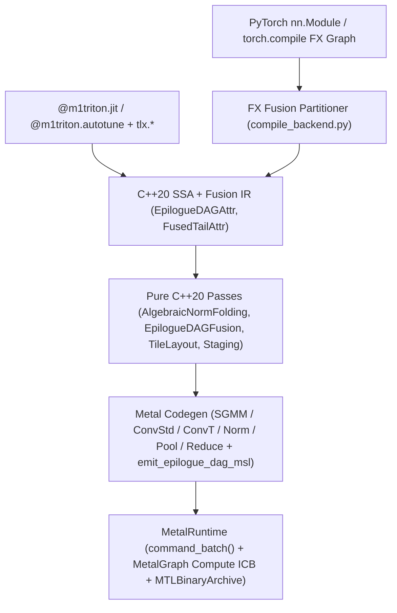

# M1Triton v2.0 Fusion Architecture ("Better Triton on MPS")

M1Triton v2.0 unifies two complementary compilation layers on top of one pure C++20 SSA + Fusion IR (`cpp/ir/`, `cpp/passes/`) and Apple M1 Max Metal backend (`cpp/codegen/metal/`, `cpp/runtime/`):

1. **Kernel-Author Layer (`@m1triton.jit`, `@m1triton.autotune`, `@m1triton.heuristics`, `tl.*`, `tlx.*`)**: Write custom Triton algorithms and hardware-specialized fused kernels compiled directly to Metal Shading Language (`MTLBinaryArchive` disk-cached).
2. **Model-Compiler Layer (`torch.compile(model, backend="m1triton")`)**: Reuses PyTorch TorchDynamo + AOTAutograd FX graph capture (`python/m1triton/compile_backend.py`) to fuse ATen subgraphs into cached M1Triton Metal kernels without reinventing PyTorch's allocator or autograd engine.

## Fusion Hierarchy

### 1. Register-Level Epilogue DAG Fusion (`EpilogueDAGAttr`)
- **Ops**: 45 composable `EpilogueOpKind` steps covering constants, per-channel bias (`Add/Sub/Mul/Div/Min/MaxBias`), runtime scalars, full-tensor residuals (`Add/Sub/MulResidual`), 4 register save/reuse slots (`SaveReg`, `Add/Sub/MulSaved`), and activations (`ReLU`, `LeakyReLU`, `Sigmoid`, `Tanh`, `GELU`, `GELUTanh`, `Swish`, `Mish`, `HardSwish`, `HardSigmoid`, `HardTanh`, `ELU`, `SELU`, `Softplus`, `Softsign`, `Log`, `Exp`, `Abs`, `Neg`, `Sqrt`).
- **IEEE-754 Safety**: `emit_epilogue_dag_msl` emits NaN-propagating `min`/`max`/`clamp` comparisons, exact `NAN`/`INFINITY` literals, `-INFINITY`-safe `HardSwish`, and 64-bit `elem_idx` addressing across SGMM (`mma2` registers & SRAM), ConvStd (Implicit-GEMM + Winograd `F(2x2)`/`F(4x4)`), ConvTranspose (`HALO`/`FUSE_SW`), Norm/Softmax, Pool, and Reduce emitters.
- **Zero Overhead When Unused**: Emitters fall through to byte-identical v1.0 MSL when `epilogue_dag` is absent.

### 2. Producer-Consumer Tile Reduction Tails (`FusedTailAttr`)
- **SGMM**: Fuses `RowSum`, `RowMean`, `RowMax`, `RowMin`, `RowLogSumExp`, `Pool1DMax`, and `Pool1DAvg` directly across `mma2` SIMD fragments via `simd_shuffle_xor(1/8)` and compact `BM * sg_n` SRAM staging, writing only `(M, grid_n)` or `(M, N // k)` partials.
- **ConvStd & ConvTranspose**: Fuses `SpatialGlobalAvgPool`, `SpatialGlobalSum`, and `SpatialGlobalMax` via `simd_sum` / NaN-propagating `m1_simd_nanmax` before storing compact `(N, C_out, grid_x)` partials, eliminating multi-GB intermediate 4D/5D activations.

### 3. Metal Runtime Execution Graphs (`cpp/runtime/metal_runtime.mm`)
- **`command_batch(wait=True, sync_mps=True)`**: Encodes sequential M1Triton dispatches onto a single `MTLCommandBuffer` with one optional MPS sync at entry and one wait at exit (`1.60x` lower latency than per-kernel command buffers on 10-kernel chains `[measured]`).
- **`MetalGraph` (Compute ICB)**: Captures static multi-kernel pipelines into Apple M1 Max Metal 3 `MTLIndirectCommandBuffer` (`MTLIndirectCommandTypeConcurrentDispatch`) with automatic RAW/WAW/WAR memory barriers (`0.0148 ms` CPU replay overhead, `5.26x` lower CPU cost than unbatched dispatches `[measured]`).

### 4. Production `@m1triton.autotune` & `@m1triton.heuristics`
- Maps Triton `Config(..., num_warps=...)` to Apple M1 Max `num_simdgroups` (`32` threads/SG), pre-prunes configs exceeding `32 KB` SRAM or live `[pso maxTotalThreadsPerThreadgroup]`, benchmarks using native `MTLCommandBuffer` GPU timestamps with `reset_to_zero`/`restore_value`, and persists winners atomically under `~/.cache/m1triton/autotune/` (`M1TRITON_CACHE_DIR`).
